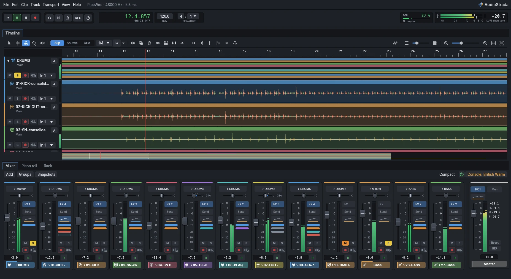
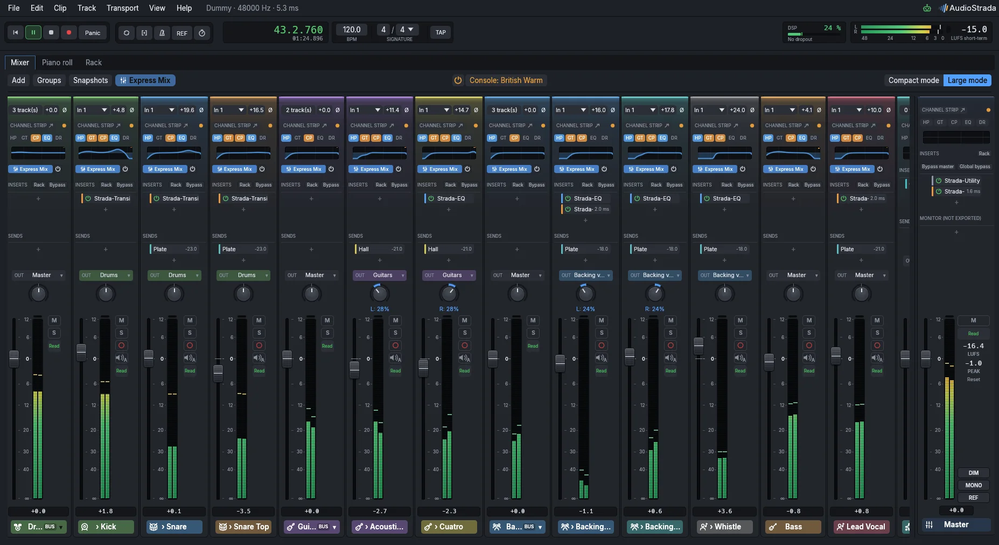
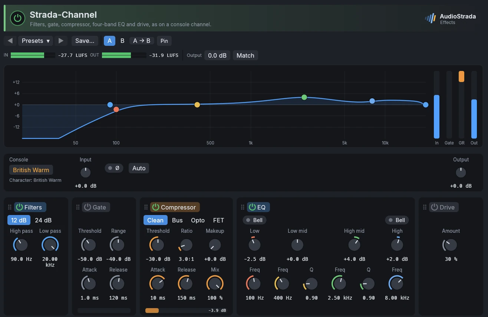
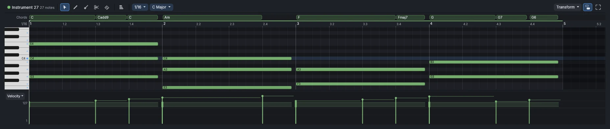

<p align="center">
  
</p>

<h1 align="center">AudioStrada</h1>

<p align="center"><strong>From the first take to the final mix. Faster.</strong></p>

<p align="center">
  <a href="https://github.com/audiostrada/audiostrada/actions/workflows/ci.yml"></a>
  <a href="LICENSE"></a>
  
  <a href="rust-toolchain.toml"></a>
</p>

<p align="center">
  <a href="https://audiostrada.com">Website</a> ·
  <a href="https://audiostrada.com/download">Download</a> ·
  <a href="https://audiostrada.com/manual/">Manual</a> ·
  <a href="https://github.com/audiostrada/audiostrada/discussions">Discussions</a>
</p>



AudioStrada is a complete audio workstation for Linux, Windows and macOS. It opens instantly,
runs at low latency and records in 32-bit float up to 192 kHz, with a mixing console, pro
effects, a guitar amp and your plugins built in. It is free software, under the GNU GPL.

AudioStrada is in active development: features land quickly, and some rough edges remain.

## Features

- **Recording**: punch-in, loop recording with every pass on its own take lane, comping,
  playlists, count-in and metronome, input latency compensation, low-latency monitoring.
- **Editing**: Smart Tool, fades and crossfades, clip gain, Slip, Shuffle and Grid modes, time
  ranges, markers, time-stretch and transpose, clips matched to the project tempo.
- **Mixing**: a console with effects and sends on every strip, buses made from the selection
  in one click, groups, VCAs, snapshots, sidechain, console colors, monitor effects and a loudness meter.
  Automation with curves and Read, Touch, Latch, Write and Trim modes. Track freeze.
- **Effects**, each with its own editor, factory presets, A/B and loudness matching: EQ and
  Vintage EQ, Compressor (Clean, Bus, Opto, FET), Channel Strip, Gate, Limiter, Maximizer,
  Transient Shaper, De-esser, Pitch Correct, Reverb, Delay, Chorus, Flanger, Phaser, Drive, Tape,
  Filter, Stereo Imager, Utility, Analyzer and Tuner.
- **Guitar**: an amp with 16 built-in models, 21 pedals and cabinet impulse responses, which
  also runs Neural Amp Modeler captures from your library or TONE3000.
- **MIDI**: an MPE synth, a drum machine, plugin instruments, a piano roll with controller
  lanes, MIDI devices, overdub, MIDI learn, `.mid` import and export.
- **Plugins**: CLAP, VST3, VST2 and LV2 with their own windows, each plugin in its own process so a
  crashing plugin cannot take the session with it.
- **Export**: WAV, FLAC, MP3 and Opus, dither, peak or LUFS normalization, stems and a render
  queue.
- **Workflow**: autosave, crash recovery and project versions, a dockable workspace with
  detachable panels, themes, a command palette, and editable shortcuts with AudioStrada,
  Pro Tools, Logic and Reaper presets.
- **AI assistants**: Claude, Cursor or Gemini can drive AudioStrada through the Model Context
  Protocol, from the robot button.

| | | |
|:-:|:-:|:-:|
|  |  |  |
| Mixer | Effect editors | Piano roll |

## Get AudioStrada

**Official builds.** Signed installers for Linux (`.deb`, `.rpm`, AppImage), Windows and macOS
are on [audiostrada.com](https://audiostrada.com/download). They are free to try: without a
license, the sound drops out briefly every 10 minutes after the first 20. A yearly subscription
removes the dropouts, brings every update of the year and funds the development; every version
released during the subscription stays yours.

**From source.** The same software with no limit at all. On Debian or Ubuntu:

```sh
sudo apt install build-essential libpipewire-0.3-dev libspa-0.2-dev libclang-dev libasound2-dev libjack-jackd2-dev
cargo run --release -p audiostrada-app
```

Other Linux distributions, Windows, macOS and packages: see [docs/building.md](docs/building.md).

## Audio backends

| Platform | Backends (auto-detection order) |
|---|---|
| Linux | PipeWire (native), JACK, ALSA |
| Windows | WASAPI (shared, low-latency engine periods when available), ASIO |
| macOS | CoreAudio |

A `dummy` backend without hardware is always available for tests.

## Projects

A project is a folder holding `Name.strada`, the imported media (`Audio Files/`) and peak caches
(`Peaks/`). Projects are autosaved every 30 s; after a crash, AudioStrada offers to recover
unsaved work. Supported audio formats: WAV, AIFF, FLAC, MP3, Ogg Vorbis, CAF and ALAC, resampled
to the session rate when loaded.

<details>
<summary><strong>Command line</strong></summary>

| Command | Purpose |
|---|---|
| `audiostrada [FILE...]` | Opens the main window with a project or audio files |
| `audiostrada diagnose` | Checks real-time priority, PipeWire buffers, CPU governor and kernel preemption, with fixes |
| `audiostrada devices` | Lists audio devices |
| `audiostrada tone` | Plays a 440 Hz test tone at -18 dBFS on every output |
| `audiostrada monitor` | Shows input levels |
| `audiostrada play FILE...` | Plays files together, one track each (`--loop` to loop) |
| `audiostrada render FILE... --output mix.wav` | Mixes files offline into a 32-bit float WAV |
| `audiostrada latency` | Measures the round-trip latency through a loopback (output 1 to input 1) |
| `audiostrada compare A B` | Compares two files sample by sample (null test) |
| `audiostrada plugins [--rescan]` | Lists the installed plugins, scanning new ones |
| `audiostrada mcp [--connect PORT]` | Serves the Model Context Protocol, headless or driving a window started with `--control PORT` |

`audiostrada help` lists every option. Log verbosity is set with `AUDIOSTRADA_LOG`, for example
`AUDIOSTRADA_LOG=debug,audiostrada::rt=trace`.

</details>

<details>
<summary><strong>Development</strong></summary>

AudioStrada is written in Rust.

| Crate | Role |
|---|---|
| `audiostrada-core` | Project model, undo and redo, versioned serialization |
| `audiostrada-engine` | Real-time audio graph, scheduler, transport |
| `audiostrada-io` | Audio backends |
| `audiostrada-plugins` | Plugin hosting |
| `audiostrada-dsp` | Built-in effects |
| `audiostrada-media` | Decoding, encoding, resampling, peak files |
| `audiostrada-midi` | MIDI devices, clips and files |
| `audiostrada-ui` | User interface (egui and wgpu) |
| `audiostrada-license` | Licenses of the official builds |
| `audiostrada-rt` | Real-time safety tooling |
| `audiostrada-app` | Application binary |

Code running on the audio thread must not allocate, lock or make system calls:

- wrap audio callbacks in `audiostrada_rt::rt_section`; in debug builds any allocation inside is
  reported (`audiostrada_rt::alloc_violations`);
- talk to other threads through `audiostrada_rt::channel` only;
- log from the audio thread with `audiostrada_rt::RtLogger`, never with `tracing` directly.

</details>

## Contributing

Bug reports and ideas are welcome in [Issues](https://github.com/audiostrada/audiostrada/issues)
and [Discussions](https://github.com/audiostrada/audiostrada/discussions). Before sending code,
read [CONTRIBUTING.md](CONTRIBUTING.md). Security issues: see [SECURITY.md](SECURITY.md).

## License

GPL-3.0-or-later, see [LICENSE](LICENSE). The AudioStrada name and logo are covered by
[TRADEMARKS.md](TRADEMARKS.md).
